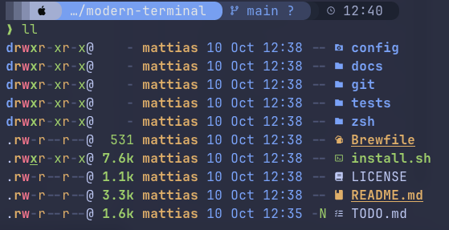
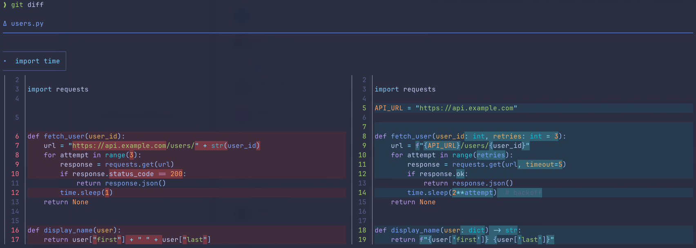

# modern-terminal

A starter kit for a modern macOS terminal: Ghostty, zsh with starship, fzf and zoxide,
fast modern command-line tools, and one Tokyo Night Storm theme across all of them.





## What you get

| Area | Tools |
|---|---|
| Terminal | Ghostty, JetBrains Mono Nerd Font |
| Shell | zsh with the starship prompt, autosuggestions, syntax highlighting, fzf, zoxide |
| Search and view | ripgrep (`rg`), fd, bat, eza, glow, jq, sd, ast-grep (`sg`) |
| Git | lazygit, delta, gh |
| Editors | Helix (`hx`), micro |
| System | btop |

The [cheat sheet](docs/cheatsheet.md) lists the commands and shortcuts.
[AI coding agents](docs/agents.md) describes agents that fit this setup.

## Requirements

- macOS
- [Homebrew](https://brew.sh)
- zsh (the default shell on macOS)

## Install

```sh
git clone https://github.com/malr0/modern-terminal.git ~/modern-terminal
~/modern-terminal/install.sh
```

Then open Ghostty from Applications. Your other terminals pick up the shell setup in
any new window.

Keep the cloned folder: your shell loads the kit from it. To update:

```sh
git -C ~/modern-terminal pull
```

## What the installer changes

It adds to your setup and never overwrites a file, so running it again is safe.

1. Installs the tools in the [Brewfile](Brewfile) with `brew bundle`.
2. Adds two lines to the end of `~/.zshrc`:
   ```sh
   # modern-terminal
   source "/Users/you/modern-terminal/zsh/kit.zsh"
   ```
   Anything you put after these lines overrides the kit.
3. Adds [git/delta.gitconfig](git/delta.gitconfig) to your global git config with
   `include.path`, so `git diff`, `git log -p` and lazygit use delta. Your name, email
   and other git settings are not touched. If your git config already sets a pager,
   `interactive.diffFilter`, `merge.conflictStyle` or any `delta.*` option, the installer
   leaves git alone and says so, since the include would override them.
4. Copies the Tokyo Night configs from [config/](config) for each tool, **only where you
   don't have that file yet**. `XDG_CONFIG_HOME` is respected if you've set it. The summary at the end lists what was `installed` and
   what was `skipped (exists)`.

`kit.zsh` sets `EDITOR` to Helix only if you haven't set an editor yourself.

## Oh My Zsh and other prompt setups

If you use Oh My Zsh, Prezto or Powerlevel10k, you may see two prompts or plugins
loading twice. In Oh My Zsh, set `ZSH_THEME=""` so starship is the only prompt, and remove
`zsh-autosuggestions` and `zsh-syntax-highlighting` from your `plugins=(...)` list.

## Uninstall

1. Delete the two lines starting with `# modern-terminal` from `~/.zshrc`.
2. Remove the git include:
   ```sh
   git config --global --fixed-value --unset include.path "$HOME/modern-terminal/git/delta.gitconfig"
   ```
3. Delete any copied config files you don't want. The install summary lists them.
4. Remove tools you don't want with `brew uninstall <name>`.
5. Delete the `~/modern-terminal` folder.

## Credits and licence

The kit is released under the [MIT licence](LICENSE).

The Tokyo Night colours come from [tokyonight.nvim](https://github.com/folke/tokyonight.nvim)
by Folke Lemaitre. The bat theme is taken from that project and is covered by its
[Apache-2.0 licence](config/bat/themes/LICENSE-tokyonight.txt).
